# ERD Target Rewrite Algohub

**Status:** Draft 0.1  
**Database:** satu Supabase PostgreSQL project baru/fresh  
**Identity:** `auth.users` Supabase Auth

ERD ini merupakan model target awal. Nama tabel dan atribut final harus
dicocokkan dengan feature matrix, schema production, dan keputusan migrasi.

## 1. Diagram relasi

```mermaid
erDiagram
    AUTH_USERS ||--|| USERS : identity
    USERS ||--o{ USER_ROLES : has
    ROLES ||--o{ USER_ROLES : grants
    DIVISIONS ||--o{ USER_ROLES : scopes
    ROLES ||--o{ ROLE_PERMISSIONS : grants
    PERMISSIONS ||--o{ ROLE_PERMISSIONS : defines
    USERS ||--o{ MEMBERSHIPS : belongs
    CLASSES ||--o{ MEMBERSHIPS : contains
    USERS ||--o{ AUDIT_LOGS : acts
    USERS ||--o{ FILE_ASSETS : uploads
    USERS ||--o{ NOTIFICATIONS : receives

    ACADEMIC_PERIODS ||--o{ COURSES : contains
    COURSES ||--o{ CLASSES : offers
    CLASSES ||--o{ SCHEDULES : has
    SCHEDULES ||--o{ ATTENDANCE_SESSIONS : creates
    ATTENDANCE_SESSIONS ||--o{ ATTENDANCE_RECORDS : contains
    MEMBERSHIPS ||--o{ ATTENDANCE_RECORDS : records
    INVENTORY_ITEMS ||--o{ INVENTORY_RENTALS : rented
    USERS ||--o{ INVENTORY_RENTALS : borrows

    PRACTICUM_SESSIONS ||--o{ ASSESSMENTS : contains
    ASSESSMENTS ||--o{ QUESTIONS : pools
    ASSESSMENTS ||--o{ SESSION_ACTIVATIONS : opens
    SESSION_ACTIVATIONS ||--o{ SELECTED_QUESTIONS : selects
    QUESTIONS ||--o{ SELECTED_QUESTIONS : selected
    USERS ||--o{ ASSESSMENT_ATTEMPTS : takes
    ASSESSMENTS ||--o{ ASSESSMENT_ATTEMPTS : has
    ASSESSMENT_ATTEMPTS ||--o{ ANSWERS : contains
    QUESTIONS ||--o{ ANSWERS : answers

    LEVELS ||--o{ LEARNING_MODULES : contains
    LEARNING_MODULES ||--o{ LESSONS : contains
    USERS ||--o{ LESSON_PROGRESS : tracks
    LESSONS ||--o{ LESSON_PROGRESS : tracked
    ACHIEVEMENTS ||--o{ USER_ACHIEVEMENTS : grants
    USERS ||--o{ USER_ACHIEVEMENTS : earns
    USERS ||--o{ GAME_HISTORY : plays

    AUTH_USERS {
        uuid id PK
    }
    USERS {
        bigint id PK
        uuid auth_user_id FK
        varchar nim UK
        varchar email UK
        varchar name
        boolean is_active
        boolean hidden
        timestamptz created_at
        timestamptz updated_at
    }
    ROLES {
        varchar code PK
        varchar name
    }
    USER_ROLES {
        bigint user_id FK
        varchar role_code FK
        varchar division_code FK
        jsonb scope
    }
    DIVISIONS {
        varchar code PK
        varchar name
        boolean is_active
    }
    PERMISSIONS {
        varchar code PK
        varchar app
        varchar description
    }
    ROLE_PERMISSIONS {
        varchar role_code FK
        varchar permission_code FK
        jsonb default_scope
    }
    MEMBERSHIPS {
        bigint id PK
        bigint user_id FK
        bigint class_id FK
        varchar membership_role
        int shift
        varchar group_name
    }
    AUDIT_LOGS {
        bigint id PK
        bigint actor_id FK
        varchar action
        varchar app
        varchar subject_type
        varchar subject_id
        jsonb detail
        timestamptz created_at
    }
    FILE_ASSETS {
        uuid id PK
        varchar domain
        varchar bucket
        varchar object_path
        varchar mime_type
        bigint size_bytes
        bigint uploaded_by FK
    }
    ACADEMIC_PERIODS {
        bigint id PK
        varchar name
        date starts_on
        date ends_on
    }
    COURSES {
        bigint id PK
        bigint period_id FK
        varchar code
        varchar name
    }
    CLASSES {
        bigint id PK
        bigint course_id FK
        varchar code
    }
    SCHEDULES {
        bigint id PK
        bigint class_id FK
        varchar day
        timestamptz starts_at
        timestamptz ends_at
    }
    ATTENDANCE_SESSIONS {
        bigint id PK
        bigint schedule_id FK
        timestamptz opened_at
    }
    ATTENDANCE_RECORDS {
        bigint id PK
        bigint session_id FK
        bigint membership_id FK
        varchar status
    }
    INVENTORY_ITEMS {
        bigint id PK
        varchar name
        int quantity
        varchar status
    }
    INVENTORY_RENTALS {
        bigint id PK
        bigint item_id FK
        bigint borrower_id FK
        varchar status
        timestamptz borrowed_at
    }
    PRACTICUM_SESSIONS {
        bigint id PK
        varchar title
        int sequence
        boolean active
    }
    ASSESSMENTS {
        bigint id PK
        bigint session_id FK
        varchar type
        int duration_minutes
        boolean token_required
    }
    QUESTIONS {
        uuid id PK
        bigint assessment_id FK
        varchar type
        varchar difficulty
        int module_number
        jsonb content
        jsonb grading_rules
    }
    SESSION_ACTIVATIONS {
        bigint id PK
        bigint assessment_id FK
        bigint class_id FK
        int shift
        varchar access_token
        boolean is_open
    }
    SELECTED_QUESTIONS {
        bigint activation_id FK
        uuid question_id FK
        int sequence
    }
    ASSESSMENT_ATTEMPTS {
        uuid id PK
        bigint user_id FK
        bigint assessment_id FK
        varchar status
        jsonb selected_question_ids
        jsonb answers_snapshot
        timestamptz started_at
        timestamptz submitted_at
        numeric final_score
    }
    ANSWERS {
        uuid id PK
        uuid attempt_id FK
        uuid question_id FK
        jsonb answer
        numeric score
        jsonb feedback
    }
    LEVELS {
        varchar id PK
        varchar title
        int sort_order
    }
    LEARNING_MODULES {
        varchar id PK
        varchar level_id FK
        varchar title
        int sort_order
    }
    LESSONS {
        varchar id PK
        varchar module_id FK
        varchar title
        jsonb content
        int sort_order
    }
    LESSON_PROGRESS {
        uuid id PK
        bigint user_id FK
        varchar lesson_id FK
        boolean completed
        timestamptz completed_at
    }
    ACHIEVEMENTS {
        varchar id PK
        varchar title
        varchar requirement_type
        jsonb requirement
    }
    USER_ACHIEVEMENTS {
        bigint user_id FK
        varchar achievement_id FK
        timestamptz unlocked_at
    }
    GAME_HISTORY {
        uuid id PK
        bigint user_id FK
        varchar game_type
        int xp_earned
        timestamptz played_at
    }
    NOTIFICATIONS {
        uuid id PK
        bigint user_id FK
        varchar type
        jsonb payload
        timestamptz read_at
    }
```

## 2. Keputusan model

- `auth.users` menyimpan identity/credential; `users` menyimpan profil aplikasi.
- Target project dibuat fresh; schema legacy hanya menjadi input migrasi dan
  tidak dibawa sebagai grant/function/policy production secara otomatis.
- Password tidak disimpan ulang di tabel domain.
- Role target: `koordinator`, `asisten`, `mahasiswa`, dan `peminjam`.
- Role dapat memiliki scope; satu user boleh memiliki beberapa konteks kelas,
  shift, divisi, atau sesi.
- Divisi target asisten: `sekretaris`, `bendahara`, `k3`, `labops`, `pendidikan`,
  `pdd`. Divisi disimpan sebagai assignment/capability, bukan role identity.
- Permission target disimpan eksplisit pada `PERMISSIONS` dan relasi role/divisi;
  nama divisi atau suffix kode asisten tidak boleh menjadi authorization logic.
- Console `admin.algohub.web.id` tidak membutuhkan tabel atau role `admin` baru;
  akun `asisten` memakai `USER_ROLES` dan permission/scope untuk mengakses domain
  yang diizinkan.
- `ASSESSMENTS` menjadi satu mesin untuk pre-test, post-test, keterampilan, dan
  ujian praktik.
- `FILE_ASSETS` menyimpan metadata object; isi file berada di bucket domain.
- `AUDIT_LOGS` menjadi audit bersama untuk seluruh aplikasi.

## 3. Constraint penting

- `users.auth_user_id`, `users.email`, dan `users.nim` unique bila tidak null.
- `user_roles(user_id, role_code, scope)` unique.
- `memberships(user_id, class_id, membership_role, shift)` unique.
- `answers(attempt_id, question_id)` unique.
- `lesson_progress(user_id, lesson_id)` unique.
- `user_achievements(user_id, achievement_id)` unique.
- `file_assets.bucket` hanya boleh berisi `portal`, `siakad`, `elearning`, atau
  `praktikum`; object path dibuat server.

## 4. Security/RLS

- Client tidak menerima service role key.
- User hanya membaca progress, nilai, jawaban, dan file miliknya.
- Pengajar/asisten hanya mengubah resource dalam scope yang dimiliki.
- Akses admin terpusat tetap dibatasi `USER_ROLES`, permission, dan scope; host
  `admin.algohub.web.id` bukan authorization boundary.
- Audit log ditulis backend dan dibaca role berwenang.
- RLS aktif pada tabel yang dapat diakses melalui Supabase; Go API tetap
  memvalidasi permission dan ownership.

## 5. Mapping legacy yang wajib dikerjakan

- Variasi tabel user dan role dari siakad, e-learning, dan praktikum.
- Referensi e-learning berbasis NIM versus referensi berbasis ID.
- `student_progress` versus cache progres e-learning.
- Mesin asesmen e-learning versus tabel asesmen praktikum.
- JWT/login legacy, `sso_handshakes`, dan `token_blocklist`.
- Tabel praktikum, inventaris, penyewaan, jadwal, absensi, dan RPC siakad.
